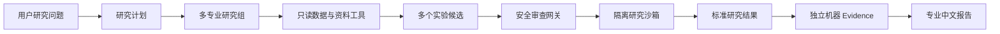

# AlphaForge · 千因研究院

<p align="center">
  <strong>自主多智能体 Alpha 研究平台</strong><br/>
  千种假设，一套证据，一个答案。
</p>

<p align="center">
  
</p>

<p align="center">
  <a href="https://www.python.org/"></a>
  <a href="https://fastapi.tiangolo.com/"></a>
  <a href="https://react.dev/"></a>
  <a href="LICENSE"></a>
</p>

> **提出一个 Alpha 研究问题，让一支 AI 量化研究团队完成调查、实验、验证与报告。**

AlphaForge 面向中国 A 股研究场景，将自然语言问题转化为一项有限、可追踪的研究任务。多个专业研究组自主制定计划、调查数据、设计候选和编写实验；安全沙箱负责执行，独立机器证据服务负责计算指标，最终交付一份结论清晰、过程完整、数字可追溯的专业中文研究报告。

[快速开始](#快速开始) · [研究流程](#从问题到答案) · [专业研究组](#六大专业研究组) · [示例问题](examples/questions.md) · [架构文档](docs/alphaforge/ARCHITECTURE.md) · [开发指南](CONTRIBUTING.md)

## 一句话体验

```powershell
alphaforge research "在大 A 市场寻找预测未来 20 日收益、与现有动量低相关的 Alpha，并比较成本后表现。"
```

AlphaForge 会自动完成：

```text
理解研究问题
→ 选择专业研究组
→ 调查数据与已有证据
→ 形成多个研究候选
→ 审查并隔离运行实验
→ 独立计算机器 Evidence
→ 汇总支持、反对与冲突
→ 生成正式中文研究报告
```

## 为什么是 AlphaForge

### 自主研究，而不是模板问答

研究 Agent 可以主动规划、调用获准的数据工具、选择并披露代理变量、编写多种实验、自我质疑并修订。系统固定的是数据身份、安全边界和证据标准，而不是研究员的思考方式。

### 多专业协作，而不是单模型独白

同一个问题可以由多个研究组独立提出假设。系统保留研究分歧，通过同一套机器证据比较候选，让最终报告同时呈现支持证据、反对证据和适用条件。

### 机器证据，而不是模型自报指标

研究模型负责提出候选和解释，独立服务负责数据时点、标准结果表、IC/ICIR、成本、换手、稳定性、相关性和增量性等计算。研究过程与结论分工清晰。

### 从结论到过程，全链路可解释

报告不仅回答“结果是什么”，还会展示系统如何理解问题、研究了哪些可能性、为什么选择这些实验、哪些候选被拒绝、数字意味着什么，以及下一项最值得做的实验。

## 六大专业研究组

| 专业研究组 | 主要研究方向 |
|---|---|
| 基本面研究组 | 估值、盈利能力、成长、现金流、财务质量与资产负债结构 |
| 预期与事件研究组 | 财报、业绩预告、业绩快报、预期变化和事件后漂移 |
| 市场行为与交易结构研究组 | 动量、反转、波动、成交量、换手、流动性和交易成本 |
| 另类信息研究组 | 新闻、研报、关注度、资金流、龙虎榜和其他辅助信息 |
| 宏观状态研究组 | 利率、指数状态、风险偏好、市场波动和流动性环境 |
| 组合增量研究组 | 因子相关性、残差 Alpha、组合缺口、增量价值和因子衰减 |

系统根据问题选择一个到多个研究组；每组拥有独立上下文、工具视图、预算和产物空间。

## 从问题到答案



一次合法研究可以得到明确支持、条件性支持、否定结论、部分研究结果或具体的数据需求。每种结果都保留已完成的研究过程和下一步行动。

## 适合研究的问题

```text
挖掘 50 日动量的成交量确认、波动调整和流动性过滤变体。

ROE、经营现金流和估值组合能否预测未来 20 日收益？

财报公告后的价格反应是延续还是反转？

高低 Shibor 状态下，哪些 Alpha 更稳定？

寻找与现有动量和价值因子低相关的新增 Alpha。

某个因子近期为什么衰减，应该修订、缩减还是继续观察？
```

更多可直接使用的问题见 [研究问题示例](examples/questions.md)。

## 快速开始

### 1. 安装

```powershell
git clone https://github.com/xxxhhbb/AlphaForge.git
Set-Location AlphaForge

python -m venv .venv
.\.venv\Scripts\Activate.ps1
python -m pip install --upgrade pip
pip install -e ".[dev]"
```

### 2. 运行离线演示

```powershell
alphaforge demo --offline --seed 7
```

离线演示使用仓库内的小型冻结数据，不需要模型密钥。

### 3. 启动本地研究服务

```powershell
Set-Location frontend
npm ci
npm run build
Set-Location ..

alphaforge serve --host 127.0.0.1 --port 8000
```

打开 <http://127.0.0.1:8000>。

### 4. 启用真实研究模型

```powershell
Copy-Item agent\.env.example agent\.env
```

在本机 `agent/.env` 配置兼容的模型 Provider，然后运行：

```powershell
alphaforge research "成交量确认能否增强 50 日动量，并预测未来 20 日收益？" `
  --label-horizon 20 `
  --print-report
```

配置文件、密钥和研究产物默认不会进入 Git。

## 研究报告包含什么

每份报告围绕用户问题组织，包含：

- 一句话机器结论；
- 实际测试了什么；
- 每个专业研究组的假设与实验路线；
- 候选定义和研究代码摘要；
- 数据范围、覆盖率和时间语义；
- 成本后表现、换手、稳定性和增量性；
- 支持证据、反对证据和分支冲突；
- 对原问题的逐项回答；
- 下一项最有价值的实验。

示例见 [客户研究报告](examples/sample-report.md)。

## 可信研究架构

AlphaForge 将开放式研究能力和确定性证据能力组合在同一条产品路径中：

| 层 | 职责 |
|---|---|
| Research Agent | 规划、调查、提出候选、编写实验和解释结果 |
| Research Toolbox | 行情、财务、事件、宏观、资料和因子库等只读研究工具 |
| Review Gateway | 研究完整性审查、字段闭包、静态安全与权限检查 |
| Research Sandbox | 固定资源、无网络、冻结数据上的隔离实验运行 |
| Evidence Service | 独立计算机器指标、成本、稳定性、增量性和统计证据 |
| Report Composer | 将研究过程和机器事实组织成客户可读中文报告 |

完整设计见 [架构文档](docs/alphaforge/ARCHITECTURE.md) 和 [安全与权限](docs/alphaforge/SECURITY_AND_AUTHORITY.md)。

## 项目结构

```text
agent/
  alphaforge_cli.py             # AlphaForge 公开命令入口
  alphaforge_api_server.py      # 本地 Research OS 与 UI 服务
  src/agent/                    # 有界研究 AgentLoop
  src/swarm/                    # 多研究组并行与依赖调度
  src/tools/                    # 数据和资料工具
  src/veriquant/                # 冻结数据、Evidence、报告与可信研究内核
  tests/veriquant/              # 产品、证据、PIT、安全和回放测试

frontend/                       # AlphaForge 中文研究界面
docs/alphaforge/                # 架构、配置、API、安全和开发文档
examples/                       # 研究问题与客户报告示例
```

## 开发与测试

```powershell
python scripts\check_alphaforge_docs.py

python -m pytest -q -p no:cacheprovider --confcutdir=agent/tests/veriquant `
  agent/tests/veriquant/research_answer `
  agent/tests/veriquant/agent_research_product

Set-Location frontend
npm run test:run
npm run build
```

贡献前请阅读 [CONTRIBUTING.md](CONTRIBUTING.md) 与 [SECURITY.md](SECURITY.md)。

## Roadmap

- 更丰富的 A 股数据冻结与双时态研究面板；
- 更强的事件研究、状态比较和组合增量实验；
- 可恢复的长时多研究组任务；
- 研究报告可视化与共享；
- 因子注册、衰减诊断和持续研究；
- 更完整的离线部署与可复现发布包。

详细路线见 [AlphaForge Roadmap](docs/alphaforge/ROADMAP.md)。

## 致谢

感谢 Vibe-Trading、Qlib 及开源量化与智能体社区提供的优秀基础设施与启发。

## License

[MIT License](LICENSE)。第三方代码、数据接口和因子定义的归属与许可见 [NOTICE](NOTICE) 及相关目录说明。
