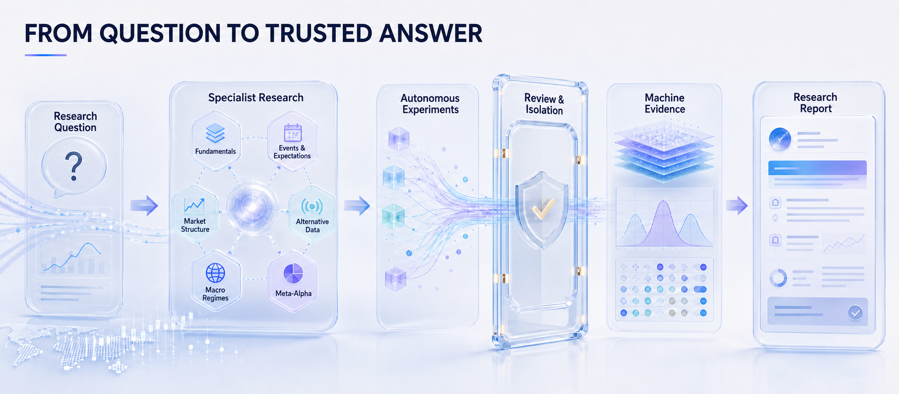

  <strong>English</strong> · <a href="README_zh-CN.md">简体中文</a>

  

<h1 align="center">AlphaForge</h1>

  <strong>Autonomous Multi-Agent Alpha Research OS</strong> 
  From an open-ended market question to an evidence-bound answer.

  
  
  
  
  
  

  <a href="#why-alphaforge">Why AlphaForge</a> ·
  <a href="#how-it-works">Workflow</a> ·
  <a href="#six-specialist-desks">Research Desks</a> ·
  <a href="#quick-start">Quick Start</a> ·
  <a href="#documentation">Documentation</a> ·
  <a href="CONTRIBUTING.md">Contributing</a>

---

AlphaForge turns a natural-language alpha question into a bounded, replayable research campaign. A coordinated team of specialist agents explores hypotheses, builds formulas, requests experiments, challenges weak evidence, and compiles an answer-first research report.

The core design principle is simple:

> **Agents explore. Deterministic evidence decides.**

> [!IMPORTANT]
> AlphaForge is a research system. It does not place orders, control brokerage accounts, manage capital, or provide financial advice. Dynamic or unpinned data is treated as auxiliary until it passes the deterministic evidence path.

## One question. One research campaign.

~~~powershell
alphaforge research "Can earnings-revision breadth predict 20-day excess returns?" --label-horizon 20 --print-report
~~~

**Question** → **Plan** → **Parallel specialist research** → **Review** → **Sandbox experiment** → **Evidence** → **Answer**

The result is more than a chat transcript. AlphaForge produces a research answer, evidence cards, experiment artifacts, coverage and failure disclosures, factor provenance, and replay metadata.

## Why AlphaForge

<table>
  <tr>
    <td width="33%"><strong>Autonomous exploration</strong> The system decomposes a question, assigns specialists, follows evidence, and revises weak hypotheses.</td>
    <td width="33%"><strong>Six specialist desks</strong> Fundamentals, events, market structure, alternative data, macro regimes, and meta-alpha work in parallel.</td>
    <td width="33%"><strong>Formula understanding</strong> AST, unit, domain, timing, and horizon checks evaluate what a formula means—not only whether it parses.</td>
  </tr>
  <tr>
    <td><strong>Isolated experiments</strong> Reviewed code runs in a pinned, no-network sandbox against controlled datasets.</td>
    <td><strong>Evidence before confidence</strong> Deterministic services compute metrics, provenance, coverage, and status labels.</td>
    <td><strong>Answer-first reporting</strong> Every conclusion exposes its support, limits, failed branches, and reproducibility path.</td>
  </tr>
</table>

### What a trustworthy answer contains

| Layer | What AlphaForge records |
| --- | --- |
| Conclusion | Direct answer, confidence, applicable horizon, and decision boundary |
| Evidence | Metric values, baselines, robustness checks, and evidence status |
| Coverage | Symbols, dates, universe, missingness, and excluded observations |
| Provenance | Dataset fingerprint, formula identity, runtime, seed, and artifact paths |
| Failure disclosure | Rejected formulas, unavailable data, weak branches, and unresolved risks |
| Replay | Stable inputs and commands required to reproduce the accepted result |

## How it works

  

### Authority by design

| Component | May do | May not do |
| --- | --- | --- |
| AgentLoop / Swarm | Plan, investigate, call registered tools, debate, and propose experiments | Declare an unverified result official |
| Review gateway | Inspect formula semantics, timing, tool policy, and experiment intent | Manufacture missing evidence |
| Sandbox | Run approved research code against mounted data | Access the network or escape the declared workspace |
| Evidence service | Compute official metrics, fingerprints, coverage, and status | Rewrite conclusions to please an agent |
| Report compiler | Bind claims to evidence and disclose limitations | Hide failed or blocked branches |

This separation lets AlphaForge preserve the creativity of an agent system without granting language models financial or evidentiary authority.

## Six specialist desks

| Desk | Core questions | Typical outputs |
| --- | --- | --- |
| **Fundamental Research** | What does the company earn, own, owe, and reinvest? | Profitability, quality, valuation, balance-sheet factors |
| **Expectations & Events** | What changed relative to expectations, and when? | Revisions, surprises, event windows, catalyst hypotheses |
| **Market Structure** | How do liquidity, crowding, and trading mechanics shape the signal? | Turnover, impact, microstructure, tradability diagnostics |
| **Alternative Data** | Can non-traditional observations add timely information? | Data-quality notes, feature proposals, availability boundaries |
| **Macro & Regime** | When should the signal strengthen, weaken, or invert? | Regime labels, conditional results, macro sensitivity |
| **Meta-Alpha** | Is the claimed edge robust, distinct, and reproducible? | Leakage review, ablations, correlation, robustness, evidence audit |

Each desk has its own identity and method, but all accepted claims must converge on the same evidence contract.

## Product surfaces

| Surface | Purpose |
| --- | --- |
| **Research Workspace** | Launch a question, watch desk activity, inspect review decisions, and track campaign progress |
| **Results & Reports** | Read the direct answer first, then drill into evidence, limitations, and artifacts |
| **Evidence Explorer** | Inspect official/auxiliary/blocked evidence, dataset fingerprints, and replay metadata |
| **Factor Library** | Compare formula semantics, quality, lineage, and historical experiment results |
| **CLI & API** | Automate campaigns, run reproducible demos, and integrate external research workflows |

## Quick start

### 1. Run the deterministic offline demo

No model key or market-data credential is required.

~~~powershell
git clone https://github.com/xxxhhbb/AlphaForge.git
Set-Location AlphaForge

python -m venv .venv
.\.venv\Scripts\Activate.ps1
python -m pip install --upgrade pip
pip install -e ".[dev]"

alphaforge demo --offline --seed 7
~~~

On macOS or Linux, activate the environment with <code>source .venv/bin/activate</code>.

The demo writes a reproducible campaign under <code>agent/runs/</code>. Start with:

- <code>report/research_answer.md</code> — the direct research answer;
- <code>report/research_report.md</code> — the full campaign report;
- <code>evidence/</code> and <code>experiments/</code> — accepted evidence and replayable artifacts.

### 2. Launch the web product

~~~powershell
Set-Location frontend
npm ci
npm run build
Set-Location ..

alphaforge serve --host 127.0.0.1 --port 8000
~~~

Open <http://127.0.0.1:8000>. The default bind is loopback-only.

### 3. Connect a model provider and run a real campaign

~~~powershell
Copy-Item agent\.env.example agent\.env
# Add the provider and data settings described in docs/alphaforge/QUICKSTART.md

alphaforge research "Which quality signals remain robust after sector neutralization?" --label-horizon 20 --print-report
~~~

For Docker, data mounting, provider configuration, and local deployment, see the [Docker guide](docs/alphaforge/DOCKER.md) and [Quick Start](docs/alphaforge/QUICKSTART.md).

<strong>Useful CLI paths</strong>

~~~text
alphaforge demo       # deterministic offline campaign
alphaforge research   # autonomous research campaign
alphaforge serve      # API + built frontend
alphaforge version    # version and build information
~~~

Explore options with <code>alphaforge &lt;command&gt; --help</code>. Example questions are available in [examples/questions.md](examples/questions.md), and a representative output is in [examples/sample-report.md](examples/sample-report.md).

## Documentation

| Goal | Start here |
| --- | --- |
| Install and run | [Quick Start](docs/alphaforge/QUICKSTART.md) · [Docker](docs/alphaforge/DOCKER.md) · [Troubleshooting](docs/alphaforge/TROUBLESHOOTING.md) |

## Contributing

We welcome focused issues and pull requests. Read [CONTRIBUTING.md](CONTRIBUTING.md) before opening a change.

## Acknowledgements

Thanks to Vibe-Trading, Qlib, RD-Agent, and the open-source quantitative research and agent communities.

## License and disclaimer

Released under the [MIT License](LICENSE).

This repository is for research and education only. Outputs may be incomplete, stale, biased, or wrong. Nothing in AlphaForge constitutes investment advice, a recommendation, an offer, or an instruction to trade. You remain responsible for data rights, model-provider terms, validation, risk controls, and every real-world decision.

  <strong>AlphaForge</strong> 
  Many hypotheses. One evidence contract. A clearer answer.

