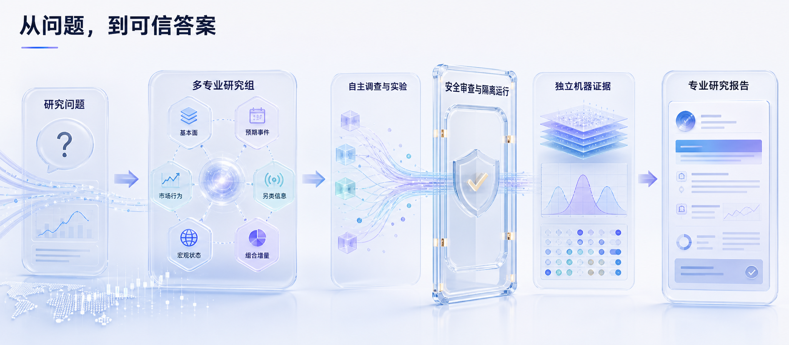

  <a href="README.md">English</a> · <strong>简体中文</strong>

  

<h1 align="center">AlphaForge · 千因研究院</h1>

  <strong>自主多智能体 Alpha 研究操作系统</strong> 
  从一个开放问题，到一个受证据约束的答案。

  
  
  
  
  
  

  <a href="#为什么是-alphaforge">为什么选择</a> ·
  <a href="#系统如何工作">研究流程</a> ·
  <a href="#六个专业研究组">六大研究组</a> ·
  <a href="#快速开始">快速开始</a> ·
  <a href="#文档地图">文档地图</a> ·
  <a href="CONTRIBUTING.md">参与贡献</a>

---

AlphaForge（千因研究院）把自然语言提出的 Alpha 问题，转化为一场有边界、可回放的自主研究活动。多个专业研究组协作探索假设、构造公式、申请实验、质疑薄弱证据，最后形成“答案优先”的研究报告。

整个系统遵循一个核心原则：

> **智能体负责探索，确定性证据负责裁决。**

> [!IMPORTANT]
> AlphaForge 是研究系统，不下单、不接管券商账户、不管理资金，也不提供投资建议。动态或未固定的数据在通过确定性证据链之前，只能作为辅助信息。

## 一个问题，一场完整研究

~~~powershell
alphaforge research "盈利预测上修广度能否预测未来 20 日超额收益？" --label-horizon 20 --print-report
~~~

**问题** → **规划** → **多研究组并行探索** → **审查** → **沙箱实验** → **证据** → **答案**

最终产物不只是一段对话。AlphaForge 会同时生成直接答案、证据卡片、实验产物、样本覆盖与失败披露、因子溯源信息和可回放元数据。

## 为什么是 AlphaForge

<table>
  <tr>
    <td width="33%"><strong>自主研究</strong> 系统会拆解问题、分配研究组、沿证据继续追查，并主动修正薄弱假设。</td>
    <td width="33%"><strong>六个专业研究组</strong> 基本面、预期事件、市场结构、另类数据、宏观状态与 Meta-Alpha 并行工作。</td>
    <td width="33%"><strong>理解公式含义</strong> AST、单位、定义域、时序和预测周期共同审查，而不只是检查语法能否运行。</td>
  </tr>
  <tr>
    <td><strong>隔离实验</strong> 通过审查的代码在固定、无网络的沙箱中，对受控数据执行。</td>
    <td><strong>证据先于置信度</strong> 确定性服务统一计算指标、溯源、覆盖率和证据状态。</td>
    <td><strong>答案优先的报告</strong> 每个结论都能看到支持证据、适用边界、失败分支与复现路径。</td>
  </tr>
</table>

### 一个可信答案应当包含什么

| 层级 | AlphaForge 记录的内容 |
| --- | --- |
| 结论 | 直接答案、置信度、适用周期和决策边界 |
| 证据 | 指标、基线、稳健性检验和证据状态 |
| 覆盖 | 标的、日期、股票池、缺失率和剔除样本 |
| 溯源 | 数据指纹、公式身份、运行环境、随机种子和产物路径 |
| 失败披露 | 被拒公式、不可用数据、薄弱分支和未解决风险 |
| 回放 | 复现已接受结果所需的稳定输入与命令 |

## 系统如何工作

  

### 权限由架构决定

| 组件 | 可以做 | 不可以做 |
| --- | --- | --- |
| AgentLoop / Swarm | 规划、调查、调用已注册工具、辩论和提出实验 | 把未经验证的结果宣布为正式证据 |
| 审查网关 | 检查公式语义、时序、工具策略和实验意图 | 凭空补造缺失证据 |
| 执行沙箱 | 对挂载数据运行已批准的研究代码 | 访问网络或逃离声明的工作区 |
| 证据服务 | 计算正式指标、数据指纹、覆盖和证据状态 | 为迎合智能体而改写结论 |
| 报告编译器 | 把结论绑定到证据并披露限制 | 隐藏失败或阻塞的研究分支 |

这套分工保留了智能体系统的创造力，但不会把金融权力或证据裁决权交给语言模型。

## 六个专业研究组

| 研究组 | 核心问题 | 典型产出 |
| --- | --- | --- |
| **基本面研究组** | 公司赚了什么、拥有什么、欠了什么，又如何再投资？ | 盈利、质量、估值、资产负债表因子 |
| **预期与事件组** | 什么相对预期发生了变化，变化发生在何时？ | 预期修正、超预期、事件窗口、催化剂假设 |
| **市场结构组** | 流动性、拥挤度和交易机制如何影响信号？ | 换手、冲击、微观结构、可交易性诊断 |
| **另类数据组** | 非传统观测能否提供及时增量信息？ | 数据质量说明、特征提案、可得性边界 |
| **宏观与状态组** | 信号何时增强、减弱或反转？ | 状态标签、条件结果、宏观敏感性 |
| **Meta-Alpha 组** | 所谓优势是否稳健、独立并且可复现？ | 泄漏审查、消融、相关性、稳健性与证据审计 |

每个研究组都有独立身份和研究方法，但所有被接受的结论必须汇聚到同一份证据契约。

## 产品界面

| 模块 | 用途 |
| --- | --- |
| **研究工作台** | 提交问题、观察各组活动、检查审查决定并跟踪研究进度 |
| **结果与报告** | 先读直接答案，再深入查看证据、限制和实验产物 |
| **证据浏览器** | 查看正式、辅助、阻塞证据，以及数据指纹和回放元数据 |
| **因子库** | 比较公式语义、质量、血缘和历史实验结果 |
| **CLI 与 API** | 自动化研究、运行可复现演示并接入外部工作流 |

## 快速开始

### 1. 先运行确定性的离线演示

这一步不需要模型密钥或行情数据凭证。

~~~powershell
git clone https://github.com/xxxhhbb/AlphaForge.git
Set-Location AlphaForge

python -m venv .venv
.\.venv\Scripts\Activate.ps1
python -m pip install --upgrade pip
pip install -e ".[dev]"

alphaforge demo --offline --seed 7
~~~

macOS 或 Linux 请使用 <code>source .venv/bin/activate</code> 激活环境。

演示会在 <code>agent/runs/</code> 下生成一场可复现研究。建议先看：

- <code>report/research_answer.md</code>：直接研究答案；
- <code>report/research_report.md</code>：完整研究报告；
- <code>evidence/</code> 与 <code>experiments/</code>：已接受证据和可回放实验产物。

### 2. 启动 Web 产品

~~~powershell
Set-Location frontend
npm ci
npm run build
Set-Location ..

alphaforge serve --host 127.0.0.1 --port 8000
~~~

打开 <http://127.0.0.1:8000>。默认只监听本机回环地址。

### 3. 连接模型服务并运行真实研究

~~~powershell
Copy-Item agent\.env.example agent\.env
# 按照 docs/alphaforge/QUICKSTART.md 填写模型服务与数据配置

alphaforge research "哪些质量因子在行业中性化后仍然稳健？" --label-horizon 20 --print-report
~~~

Docker、数据挂载、模型供应商配置和本地部署，请阅读 [Docker 指南](docs/alphaforge/DOCKER.md) 与 [快速开始](docs/alphaforge/QUICKSTART.md)。

<strong>常用 CLI 入口</strong>

~~~text
alphaforge demo       # 确定性离线研究
alphaforge research   # 自主研究活动
alphaforge serve      # API + 已构建前端
alphaforge version    # 版本与构建信息
~~~

使用 <code>alphaforge &lt;command&gt; --help</code> 查看完整参数。可直接复用的研究问题位于 [examples/questions.md](examples/questions.md)，代表性输出位于 [examples/sample-report.md](examples/sample-report.md)。

## 文档地图

| 目标 | 从这里开始 |
| --- | --- |
| 安装与运行 | [快速开始](docs/alphaforge/QUICKSTART.md) · [Docker](docs/alphaforge/DOCKER.md) · [故障排查](docs/alphaforge/TROUBLESHOOTING.md) |
| 使用产品 | [用户指南](docs/alphaforge/USER_GUIDE.md) · [示例问题](examples/questions.md) · [示例报告](examples/sample-report.md) |

## 参与贡献

欢迎提交边界清晰的 Issue 与 Pull Request。参与前请阅读 [CONTRIBUTING.md](CONTRIBUTING.md)。

## 致谢

感谢 Vibe-Trading、Qlib、RD-Agent 以及开源量化研究与智能体社区。

## 许可证与免责声明

本项目采用 [MIT License](LICENSE)。

本仓库仅用于研究与教育。系统输出可能不完整、过时、有偏或错误。AlphaForge 的任何内容都不构成投资建议、推荐、要约或交易指令。数据权利、模型服务条款、结果验证、风险控制和所有现实决策均由使用者自行负责。

  <strong>AlphaForge · 千因研究院</strong> 
  千种假设，一套证据，一个更清晰的答案。

