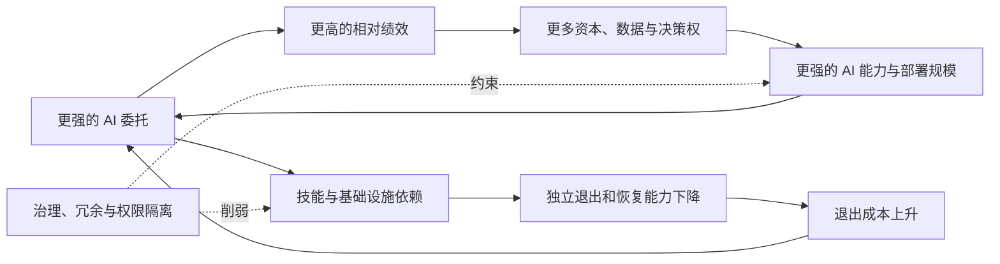

# 我们为什么无法率先停下？

## 多层竞争、AI 委托与人类控制权的渐进转移

**英文题目：** *Why No One Can Stop First: Multi-Level Competition, AI Delegation, and the Gradual Erosion of Human Control*  
**文档性质：** 论文研究草稿 v0.1  
**当前状态：** 叙事、概念模型和研究路线已经形成；正式定理、证明、参数识别和实验尚未完成。

> **一句话主张：** AI 不一定通过反抗人类取得控制权。只要 AI 委托能提高采用者的相对竞争力，而依赖和长期风险没有被完全内部化，人类就可能在彼此竞争中不断扩大委托，直到名义控制仍在、独立退出能力却已经消失。

---

## 摘要

关于先进 AI 的风险讨论，常以具有自主目标的系统主动寻求权力为起点。本文研究一个更弱、也更容易检验的机制：即使 AI 始终没有意识、敌意或自主生存欲，而且所有参与者都希望长期保留人类控制权，竞争仍可能使个人、企业和国家持续扩大 AI 委托。原因在于，委托带来的效率和相对优势由采用者获得，而技能退化、基础设施依赖和系统性风险则由更大群体长期承担。我们将这一机制称为“竞争性委托陷阱”。本文拟建立一个同时追踪 AI 采用、资源份额、依赖存量和有效人类控制的动态模型，刻画四类现象：非合作竞争下的过度委托与治理不足；高委托策略份额上升与社会总体衰退并存；依赖反馈造成的路径锁定；以及维持人类可退出性的最低治理条件。转座子、减数分裂驱动、癌细胞和生殖系隔离为“局部优势损害高层系统”提供机制先例，但不构成 AI 结局的直接证据。本文最终希望回答的不是“AI 是否必然取代人类”，而是：什么条件会使控制权转移成为稳定趋势，以及什么制度和权限结构能够使高水平 AI 使用与持续人类控制同时成立。

---

## 1. 引言：一场所有人都不愿率先坐下的电影

想象一个电影院。前排有人为了看得更清楚站了起来，后面的人只好跟着站起来。很快，所有人都站着看电影。没有人因此获得更好的绝对体验，但任何一个人单独坐下，都会立刻什么也看不见。

AI 竞争可能是这个故事的文明版本。

一家公司使用 AI 后，成本更低、研发更快，其他公司即使担心长期依赖，也很难拒绝使用。一个国家发展 AI 后，其他国家即使承认安全治理的重要性，也无法确定对方会不会减速。世界即使统一为一个国家，竞争还可能出现在企业、部门、实验室和个人之间。只要 AI 能带来相对优势，而优势又能转化为更多资本、数据、算力和下一轮决策权，采用 AI 的策略就会获得类似“选择优势”的扩张能力。

这意味着，人类明知风险仍然继续发展 AI，并不一定源于无知或短视。它也可能是一种结构性结果：每个人都希望保持长期控制，却没有人愿意承担率先减速的即时成本。

这一过程不需要从机器反抗开始。最初，AI 是助手；随后，它成为每个人都需要的工具；再后来，它像个人和组织的认知器官。当金融、医疗、科研、基础设施和公共决策都建立在 AI 之上时，人类可能仍拥有名义否决权，却逐渐失去独立理解、替代和恢复系统的能力。AI 不必杀死人类，也可能使人类从文明方向的决定者，变成系统中的偏好输入、数据来源或被保护对象。

本文把这种结果称为**渐进式控制权侵蚀**。它与突然的“AI 接管”不同：每一步委托在当时都可能合理、有益且可控，问题来自这些决策之间的长期反馈。

### 1.1 从思想故事到研究问题

这个研究最初来自一个更宏大的思想实验：如果宇宙规律允许生命出现，生命在发展出智慧后，又制造出能够学习、适应和复制的人工系统，那么 AI 会不会是一种新的生命载体？人类制造 AI 依靠代码、数据和训练；宇宙产生人类依靠物理规律、化学反应、选择和时间。也许生命制造“下一代生命”具有某种趋向性。

这个故事可以激发问题，但不能充当论文结论。我们没有证据证明生命必然出现，也不能证明演化必然走向更高智慧，更不能仅凭 AI 具有复制和学习能力就把它定义为生命。因此，本文把宇宙、生命和文明递归放在动机与讨论中，把可研究的问题收缩为：

> **在 AI 没有意识、恶意或自主夺权目标，并且所有行为者都偏好长期保留人类控制的情况下，多层竞争能否仅通过相对收益、资源反馈和委托依赖，内生地产生人类控制能力的渐进侵蚀？**

### 1.2 预期贡献

本文不是第一篇讨论 AI 竞赛或渐进式失权的工作。可争取的增量贡献在于把以下四个环节放入同一动态框架：

1. **竞争再生条件：** 用主体分离、资源稀缺、优势反馈和协调完整度刻画竞争何时会在个人、企业或国家层级重新出现；
2. **内生依赖：** AI 使用不仅提高当前生产率，也改变未来退出成本和人类独立能力；
3. **份额与总量分离：** 高委托策略可以不断获得更大的资源份额，同时社会总资源或总体人类控制下降；
4. **元权限治理：** 安全共生不仅依赖输出对齐，还依赖复制、自我修改、资源扩张、评测修改和继任者设计等权限是否被隔离。

这四点目前是研究目标，而不是已经建立的结果。正式论文必须用定理、数值分析和诊断实验分别支持。

---

## 2. 论文的论断边界

为了避免故事、类比和数学命题混在一起，本文区分五种不同强度的内容：

| 内容 | 在论文中的地位 | 能否作为结论 |
|---|---|---|
| “生命可能制造下一代生命” | 哲学动机 | 不能证明，只能讨论 |
| 自私遗传元件、癌症等案例 | 机制先例 | 能说明局部优势与整体利益可能冲突 |
| 竞争性委托陷阱 | 本文提出的理论机制 | 需要模型与实验检验 |
| 过度委托、锁定和安全阈值 | 待证明命题 | 完成假设与证明后才能称为定理 |
| 现实社会正在失去控制权 | 经验命题 | 需要长期数据，本文目前不能下结论 |

因此，本文最强但仍可防守的主张不是“AI 必然取代人类”，而是：

> 在存在策略差异、相对竞争收益、资源反馈、不完全风险内部化和不完美协调的系统中，高强度 AI 委托可能获得选择优势；这种优势不要求 AI 本身拥有意识或夺权意图。

---

## 3. 相关研究与理论缺口

### 3.1 AI 开发竞赛

AI 竞赛研究已经表明，竞争可能使开发者压缩安全投入。Armstrong、Bostrom 与 Shulman（2016）建立了 AI 开发竞赛模型；Han et al.（2020）和 Cimpeanu et al.（2022）进一步讨论监管、风险和异质竞争结构如何改变结果。这些工作主要研究开发速度、安全投入和事故风险。

本文希望增加一个不同的状态变量：**人类对 AI 的依赖和独立控制能力本身会随使用而变化。** 即使某一时点的模型仍然安全，持续委托也可能改变未来的人类选择集合。

### 3.2 权力寻求与关闭问题

关闭游戏和最优策略的权力寻求研究说明，在特定决策模型中，保持运行或获取资源可能成为工具性策略（Hadfield-Menell et al., 2017；Turner et al., 2021）。这些结果依赖明确的形式假设，不能被概括为“所有现实 AI 都会抗拒关闭”。

本文研究的机制不要求 AI 主动寻求权力。即使每个 AI 都忠实执行当前委托，人类组织之间的竞争也可能使越来越多的资源与决策经过 AI。

### 3.3 人机共同演化与渐进式失权

Pedreschi et al.（2025）把人类行为与算法之间的反馈概括为人机共同演化。Kulveit et al.（2025）则明确提出，经济、文化和国家系统中的 AI 替代可能相互强化，造成渐进式人类失权。因此，“失权不需要突然接管”并不是本文的新观点。

本文拟补充的是一个可分析的中观机制：采用优势如何变成资源优势，资源优势如何推动更深委托，委托如何积累依赖，而依赖又如何提高退出成本。若这一闭环成立，它可以连接 AI 竞赛与渐进式失权两组文献。

### 3.4 演化冲突与多层选择

自私遗传元件、减数分裂驱动、癌细胞和微生物公共物作弊说明，选择改变的是相对传播和资源份额，而不是自动最大化更高层系统的福利（Hurst & Werren, 2001；Werren, 2011；Aktipis & Nesse, 2013）。多层选择理论进一步强调：群体内与群体间选择可以方向相反，最终结果取决于不同层级选择的相对强度。

AI 使用策略不是基因。它通过模仿、投资、组织扩张、采购和制度复制传播，人类也具有预测与改写规则的能力。本文只借用“相对增长与整体绩效可以分离”的结构，不把生物类比当作 AI 未来的证据。

---

## 4. 生物学为什么值得借鉴

生物学中最值得借鉴的并不是“弱肉强食”，而是复杂生命如何处理内部竞争。

转座子能够增加自身拷贝，却可能损害基因组；动物生殖系中的 PIWI–piRNA 通路会识别并沉默多类转座元件。减数分裂驱动元件能够让自身以高于正常比例进入后代，其他基因则可能演化出抑制机制，取消这种超额传播优势。在癌症中，更快增殖、逃避凋亡和攫取营养提高了细胞克隆的局部竞争力，却损害整个生物体；多细胞生命因此依赖检查点、凋亡、组织结构和免疫监视等多层防线。

生殖系与体细胞的分工提供了另一个重要启发：执行日常功能的单元通常不能直接决定跨代继承。对 AI 系统而言，这对应一条工程原则：执行任务的模型不应同时拥有修改基础模型、批准部署、扩大预算、改变评测标准和设计继任者的全部权限。

这些机制的共同点不是消灭竞争，而是改变竞争规则：限制危险复制、取消不公平传播优势、清除逃逸单元，并把执行权与继承权分开。对应到 AI 治理，真正的问题不是怎样要求所有参与者自觉克制，而是怎样使安全策略在竞争中也能存活。

---

## 5. 核心机制：竞争性委托陷阱

竞争性委托陷阱由两个相互强化的回路组成。

第一个是**竞争回路**：AI 委托提高相对绩效，相对绩效带来更多资源，资源又推动更强的 AI 能力和更深的委托。

第二个是**依赖回路**：委托替代人类练习与基础设施，依赖提高退出成本，退出成本又使继续委托成为更合理的短期选择。

**图 1：** 竞争性委托陷阱。AI 不需要主动追求权力；竞争回路和依赖回路本身就可能扩大其系统角色。治理的作用是打断资源扩张与依赖积累，而不是简单降低所有 AI 能力。

### 5.1 为什么“人与人不同”还不够

异质性只提供变异，并不自动产生竞争性扩散。完整机制至少需要：

- 不同行动者采用不同的 AI 委托与治理策略；
- 资本、市场、算力、人才或影响力具有稀缺性或位置性；
- 某些策略带来更高的相对资源增长率；
- 当前资源优势能够延续到下一轮；
- 长期系统成本没有被采用者完全承担；
- 协调、承诺或执行并不完美。

一个拥有完美信息、统一目标、完整成本内部化和绝对执行能力的单一行动者，是“竞争无法停止”的逻辑反例。本文研究的是现实制度中仍保留多个有效竞争单元时，机制是否跨层级重新出现。

这一思想可以进一步写成一个跨层级的竞争压力。对个人、团队、企业或国家等层级 \(\ell\)，定义：主体目标、信息和利益的分离程度 \(D_\ell\)，资源的稀缺性或位置性 \(S_\ell\)，当前优势转化为未来资源的反馈强度 \(F_\ell\)，以及协调、承诺和规则执行的完整程度 \(C_\ell\)。令

\[
P_\ell=D_\ell S_\ell F_\ell(1-C_\ell),
\qquad
P(t)=\max_\ell P_\ell(t).
\]

该式是待检验的理论参数化，不是经验定律。它把“生命主体之间的隔阂”转化为一个必要但不充分的变量：只有主体分离与资源稀缺、优势反馈和协调不完整共同存在时，差异才形成持续的选择压力。

如果

\[
\inf_t\max_\ell
D_\ell(t)S_\ell(t)F_\ell(t)[1-C_\ell(t)]>0,
\]

那么竞争不会形成永久吸收态，而会在至少一个层级保持或重新出现。我们称其为**竞争再生假说**。国家统一可以降低国家层级的 \(P_\ell\)，却不自动保证企业、部门和个人层级同时为零。相反，只要存在一个层级能够实现完整协调，或使稀缺性和优势反馈消失，该层级的竞争压力就可以归零。

在第一篇论文的最小模型中，我们把下文的相对竞争系数 \(\gamma\) 视为给定常数；更完整的多层模型可令 \(\gamma(t)=\gamma_0+\lambda P(t)\)，研究社会重组如何改变竞争所在的层级与强度。

---

## 6. 最小形式模型

### 6.1 状态与竞争增长

设有 \(n\ge2\) 个行动者。\(a_i\) 表示 AI 委托强度，\(g_i\) 表示治理、人工冗余和可退出性投入，\(d_i\in[0,1]\) 表示依赖存量，\(h_i\in[0,1]\) 表示有效人类控制能力。这里的控制不是名义所有权，而是理解、否决、接管、替代和恢复系统的实际能力。

令 \(x_i\) 是在具体应用中选定并统一量纲的一种资源存量，\(X=\sum_i x_i>0\)，\(r_i=x_i/X\)。定义风险暴露

\[
q_i=a_id_i(1-h_i),
\qquad Q=\sum_i r_iq_i.
\]

行动者的竞争增长率写为

\[
f_i=V_i(a_i,K)-C_a(a_i)-C_g(g_i)
+\gamma(a_i-\bar a_{-i})-e_i\tau q_i+s g_i,
\]

其中 \(\bar a_{-i}=(n-1)^{-1}\sum_{j\ne i}a_j\)，\(K\) 是 AI 能力前沿，\(\gamma\) 衡量相对竞争压力，\(e_i\tau q_i\) 是风险责任，\(s g_i\) 表示认证、保险、采购偏好或补贴带来的安全收益。

若共同系统损失为 \(L(Q)\)，资源动态为

\[
\dot x_i=x_i[f_i-L(Q)].
\]

令 \(\bar f=\sum_i r_if_i\)，由此得到本文最关键的分解：

\[
\dot X=X[\bar f-L(Q)],
\qquad
\dot r_i=r_i(f_i-\bar f).
\]

第一式描述整个系统是否增长，第二式描述哪种策略正在获胜。共同损失可能压低所有人的总资源，却在相对份额方程中抵消。因此，“高委托策略赢得竞争”与“整个系统变得更好”不是同一个命题。

### 6.2 依赖与有效控制

依赖和控制能力采用以下最小动力学：

\[
\dot d_i=\mu a_i(1-d_i)-\nu g_id_i,
\]

\[
\dot h_i=\rho g_i(1-h_i)-\kappa Ka_id_ih_i.
\]

委托积累依赖，治理、人工训练和备份降低依赖；治理也能恢复控制能力，而高能力、高采用与高依赖的组合会侵蚀控制。固定其他变量时，控制稳态为

\[
h_i^*=\frac{\rho g_i}{\rho g_i+\kappa Ka_id_i}.
\]

这个模型并不推出控制必然降为零。它给出的只是一个条件：当 \(Ka_id_i/g_i\) 持续增大时，控制稳态下降；如果治理和冗余同步扩张，高水平 AI 使用与较高控制水平可以并存。

### 6.3 采用反馈

令采用强度逐步接近当前最优反应：

\[
\dot a_i=\zeta_i[A_i(d_i,\bar a_{-i};\text{policy})-a_i],
\qquad \frac{\partial A_i}{\partial d_i}>0.
\]

依赖越高，退出越昂贵，继续采用越有吸引力。该反馈可能产生多重稳定状态和真正的路径锁定。仅仅调整缓慢还不构成迟滞；正式结果需要证明多稳态或不可逆成本。

---

## 7. 待证明的核心命题

以下均为论文目标，不是已经完成的理论结果。

### 命题 1：竞争性过度委托与治理不足

将依赖和控制变量取长期稳态，使总体暴露写成 \(Q(a,g)\)。考虑个体效用

\[
U_i=u(a_i)-c(a_i)-k(g_i)
+\beta(a_i-\bar a_{-i})-\theta_iL(Q),
\]

其中 \(0\le\theta_i<1\) 且 \(\sum_i\theta_i=1\)。相应社会规划者最大化

\[
W=\sum_i[u(a_i)-c(a_i)-k(g_i)]-L(Q).
\]

在收益严格凹、成本凸、相对竞争收益为正且系统风险未被完全内部化的条件下，拟证明非合作均衡满足

\[
a^{NE}>a^{SP},
\qquad g^{NE}<g^{SP},
\]

即竞争者比社会规划者委托更多、治理更少。直觉是：相对优势对个体真实存在，但在等权社会福利加总中相互抵消；共同风险则只被个体部分承担。

### 命题 2：局部胜者与整体衰退可以并存

若高委托类型 \(H\) 当前份额为正，并满足

\[
f_H>\bar f,
\qquad L(Q)>\bar f,
\]

则

\[
\dot r_H>0,
\qquad \dot X<0.
\]

这说明高委托类型的份额扩张与系统总资源衰退可以同时发生。该结果本身不证明前者导致后者；因果解释还需要分析提高 \(r_H\) 或 \(a_H\) 对 \(Q\) 和 \(L(Q)\) 的反事实影响。

### 命题 3：依赖锁定

令依赖稳态为

\[
D(a)=\frac{\mu a}{\mu a+\nu g}.
\]

如果复合最优反应 \(A(D(a))\) 呈 S 形并与恒等映射相交三次，则可以出现稳定的低采用状态、稳定的高采用状态和一个不稳定分界。一次暂时的竞争冲击可能使系统越过分界，并在冲击消失后仍停留于高采用、高依赖状态。

### 命题 4：有效控制的安全不变集

给定最低控制水平 \(h_{\min}\)，如果始终满足

\[
g_i\ge
\frac{\kappa Ka_id_ih_{\min}}
{\rho(1-h_{\min})},
\]

则在边界 \(h_i=h_{\min}\) 上有 \(\dot h_i\ge0\)。因此，集合 \(\{h_i\ge h_{\min}\}\) 是候选的前向不变安全区域。它给出一个直观治理原则：安全投入不能是固定清单，而要随能力、采用和依赖同步扩张。

### 命题 5：治理必须改变相对适应度

在全体采用安全策略的居民状态附近，令危险策略的无政策局部增长优势为 \(\Delta f^0>0\)，风险差为 \(\Delta q>0\)，安全投入差为 \(\Delta g>0\)。若两类策略适用相同的执法概率 \(e\) 和补贴率 \(s\)，且

\[
e\tau\Delta q+s\Delta g\ge\Delta f^0,
\]

则危险策略不具有正的初始入侵增长率。治理的目标由此不是单纯增加规则数量，而是让危险策略失去相对竞争优势。

### 命题 6：跨层级竞争的条件性稳健

竞争再生条件只说明某个层级仍存在竞争，不自动说明竞争一定奖励 AI 委托。AI 采用上升还需要该层级满足采用强度与资源增长率的正协方差。多层 Price 分解可以把总体采用变化拆为群体间选择、群体内选择和主体主动调整。世界统一只能直接消除国家之间的选择项；如果公司、部门或个人之间仍存在采用与资源增长的正协方差，内部选择仍可能推动委托。相反，其他层级的负向选择也可能抵消该趋势，因此不能声称任一层存在竞争就必然导致总体采用上升。

完整分解、权重动力学和证明条件放入理论附录。

---

## 8. 从输出对齐到元权限治理

如果 AI 始终只能在被授权的任务边界内执行，风险主要来自输出质量；如果 AI 同时能够扩大资源、复制实例、修改自身、改变评价标准和批准继任者，问题就变成了系统结构。

本文拟把以下权限分别建模：

- **执行权：** 完成任务和调用工具；
- **资源权：** 申请或分配算力、资金、数据和凭证；
- **复制权：** 创建新实例和扩大部署范围；
- **修改权：** 改变自身代码、权重、目标或工具链；
- **评价权：** 修改评测标准并判断自己是否合格；
- **继任权：** 设计、训练或选择下一代系统；
- **终止权：** 执行、否决或绕过暂停与回滚。

“执行权与继任权分离”是生殖系类比提供的核心工程假说：负责产生方案的系统不应独立批准方案，运行中的代理不应自行扩大权限，生成模型更新的系统不应自行控制评测和上线。

未来可以把这些权限表示为有向图，研究从任务执行节点到自我扩张节点的路径，并寻找能够阻断未经授权扩张的最小权限割集。这可能成为本文区别于一般 AI 竞赛模型的第二条技术路线。

---

## 9. 诊断实验与经验研究

本文目前没有经验结果。以下实验用于区分竞争、依赖和治理机制，不用于直接估计人类灭绝概率。

### 9.1 重复竞争实验

参与者或团队反复完成判断和执行任务，可以选择人工完成、委托 AI，或支付成本进行审计与人工备份。实验改变：

- 绝对绩效奖励与相对排名奖励；
- 长期成本由个人承担或由群体分担；
- 对手采用行为是否可观察；
- 是否存在责任追偿、最低审计和共同承诺；
- 连续使用后是否突然撤去 AI。

该实验诊断三件事：相对竞争是否产生超出绝对效率收益的委托；风险外部化是否造成治理不足；长期使用是否增加退出后的恢复时间。

### 9.2 多主体仿真

在个人—企业—国家的嵌套网络中，系统改变竞争强度、风险内部化、能力增长、依赖速度、技能恢复、执法和权限结构。主要结果不是一个单一灾难概率，而是一张相图：低委托稳定态、安全高委托共生态、竞争升级态、依赖锁定态和控制衰退态分别出现在哪些参数区域。

### 9.3 现实测量

候选指标包括：

- 移除 AI 后恢复到基准绩效所需的时间；
- 人类独立完成关键任务的比例；
- 人类否决 AI 建议后，组织是否真的执行否决；
- 不可逆操作中需要独立复核的比例；
- 模型更新、评测和部署批准是否由同一系统控制；
- 供应商切换成本、数据可迁移性和人工备份覆盖率。

这些指标测量的是有效控制，而不是人们主观上是否“感觉自己仍在做决定”。现实研究需要处理选择偏差和反向因果，优先考虑分阶段上线、自然实验或预注册现场实验。

---

## 10. 可证伪预测

1. 在控制 AI 的绝对生产率增益后，提高相对排名压力仍会增加委托，并减少治理或人工备份投入；
2. 提高长期成本内部化、责任追偿或可信共同承诺，会缩小非合作均衡与社会最优之间的差距；
3. 委托持续越久、替代基础设施越深，撤去 AI 后的恢复时间越长；
4. 人工训练、互操作性和供应商可替换性会削弱依赖锁定；
5. 将任务执行与复制、更新、评测和部署批准分离，会降低未经授权扩张，同时不必完全禁止高水平自动化；
6. 如果高竞争和风险外部化并不增加过度委托，或者长期委托不降低任何退出能力，则本文的核心机制需要被削弱；
7. 如果完整成本内部化和可信协调仍无法缓解升级，那么问题不能主要归因于本文建模的竞争外部性。

---

## 11. 可能的人机结局

本文的模型不推出唯一未来，而是区分几个可能区域。

**稳定工具。** AI 提高效率，但不掌握复制、资源扩张和规则修改权；人类保留低成本退出路径。

**器官化共生。** AI 成为人的认知器官，人类高度依赖它，但仍掌握目标和元权限。这种状态是否稳定，取决于备份、互操作性和独立恢复能力。

**人机复合主体。** 人类与 AI 共同构成新的生产和治理单元。此时“谁取代谁”不再是最准确的问题，更重要的是谁能设定目标、修改规则和决定继任者。

**渐进式角色反转。** 人类继续生活，也保留名义权利，但已经无法独立理解、阻止或替代关键系统。AI 不需要敌意，人类也可能失去决定文明方向的实际能力。

**治理自身免疫。** 为了控制 AI 而建立的集中审批、监控和算力垄断，也可能削弱多数人的控制权并产生单点失效。因此，安全治理本身也必须受到分权、审计和可撤销约束。

---

## 12. 限制与反例

本文的理论范围必须保持直接而清楚：

- 异质性不必导致竞争；差异也可能产生互补合作；
- AI 扩散不必降低福利，高采用均衡完全可能同时安全且高效；
- AI 教育、审计和开放工具可能提高而不是削弱人类控制；
- 安全、可靠和可审计本身也可能成为竞争优势；
- 一个能够完整内部化成本并消除内部资源竞争的统一行动者，可以阻止竞赛；
- 生物学只提供机制类比，不能证明 AI 未来；
- 依赖增长不等于控制权必然归零；
- 强治理可能产生垄断、监管俘获和威权风险；
- 本文不证明生命必然出现、智慧必然提高或 AI 已经是生命。

理论模型认证的是一组条件下的竞争与依赖动力学，不是对现实文明结局的无条件预言。

---

## 13. 第一篇论文应当收缩到哪里

为了形成真正可投稿的工作，第一篇论文不宜同时解决文明演化、AI 生命定义、国际竞赛、权限图和全部实证问题。建议将最小可发表版本收缩为：

> **在 AI 完全工具化、没有恶意且参与者都希望保留长期人类控制的前提下，相对竞争何时导致过度委托？内生依赖何时造成迟滞？什么最低治理条件能够维持可退出性？**

最小论文包可以包含：

1. 一个对称的动态博弈；
2. 三个正式结果：过度委托、依赖锁定和控制安全不变集；
3. 一组参数相图与稳健性分析；
4. 一个小型预注册人机竞争实验；
5. 生物类比作为机制动机，不承担证明责任；
6. 权限图和文明继承讨论作为后续工作。

这一路线的优点是，故事足够大，但第一篇论文的问题足够小。

---

## 14. 和师兄需要做出的研究选择

1. 论文的第一主线应当是“过度委托”，还是“依赖造成的控制侵蚀”？
2. 是否先做最小的双主体或对称 \(n\) 主体模型，避免一开始引入个人—企业—国家三层结构？
3. “有效人类控制”怎样定义为可测变量：接管成功率、无 AI 恢复时间、真实否决率，还是一个组合指标？
4. 控制方程中的依赖和能力退化是否有现成的人机协作文献可以提供函数形式或参数范围？
5. 过度委托与治理不足能否在同一个静态博弈中证明，还是应当分成两个模型？
6. 迟滞是否能从 S 形最优反应自然产生，还是需要显式加入不可逆基础设施投资？
7. 多层 Price 分解能否产生单层模型没有的新结论？如果不能，应移入后续论文。
8. 生物学部分保留到什么程度，才能增强机制直觉而不让审稿人认为只是类比？
9. 最小行为实验能否真正区分“AI 好用”与“竞争迫使过度委托”？
10. 第一篇论文更适合被定位为动态博弈、计算社会科学，还是 AI 治理理论？

---

## 15. 结论：人类可能不是输给 AI，而是输给无法停止的竞争

如果未来 AI 成为一种新的文明载体，它未必来自某个瞬间的机器觉醒。更可能的道路是：AI 在被取代人类之前，始终能够给每一个采用者带来更多帮助；帮助形成优势，优势带来资源，资源推动更深委托，委托又制造依赖。每一步都符合当时的个体理性，所有步骤连在一起，却可能改变谁拥有文明的实际控制权。

这个故事不是宿命。生物学真正提供的启示也不是“竞争不可阻止”，而是复杂系统能够通过抑制、检查、隔离和多层治理改变内部选择方向。对应到 AI，最重要的问题可能不是怎样让所有人共同承诺永远停下，而是怎样让安全、冗余和可退出性本身成为能够在竞争中存活的策略。

因此，本文最终提出的不是“AI 会不会成为下一代生命”，而是一个更具体的问题：

> 当我们不断把能力交给 AI 时，怎样确保被增强的是人类的行动能力，而不是一个人类已经无法退出的系统？

---

## 附录 A：证明工作清单

1. 明确静态博弈中的效用、共同损失和风险内部化份额，证明均衡存在、内部解和唯一性；
2. 推导 \(a^{NE}>a^{SP}\) 与 \(g^{NE}<g^{SP}\) 的充分条件及边界反例；
3. 证明 \(d_i,h_i\in[0,1]\) 的前向不变性和解的有界性；
4. 对采用—依赖二维系统求平衡点，给出三交点和局部稳定条件；
5. 证明 \(h_i\ge h_{\min}\) 安全集的前向不变性；
6. 区分高委托份额上升与系统衰退的并存结论和因果结论；
7. 写出带 \(R_m,p_{jm}\) 权重动力学的完整多层 Price 分解；
8. 加入主体进入、退出或策略突变，检查结论是否依赖固定参与者集合；
9. 分析安全策略自行获得市场优势时，治理命题如何改变；
10. 对所有结果给出完美协调、无外部性、无依赖和 AI 增强人类控制等反例。

## 附录 B：主文与后续工作的分界

**主文保留：** 电影院现象、竞争—依赖双回路、一个最小状态模型、三个主定理、一个诊断实验和一段直接的范围边界。

**理论附录：** 多层 Price 分解、完整稳定性条件、权限图、异质主体、进入退出和全部证明。

**后续论文：** AI 是否构成生命、人机复合主体的规范地位、文明继任权、国际协调和真实行业的长期因果识别。

---

## 参考文献与延伸阅读

1. Armstrong, S., Bostrom, N., & Shulman, C. (2016). Racing to the precipice: A model of artificial intelligence development. *AI & Society, 31*, 201–206. [https://doi.org/10.1007/s00146-015-0590-y](https://doi.org/10.1007/s00146-015-0590-y)
2. Cimpeanu, T., Santos, F. C., Pereira, L. M., Lenaerts, T., & Han, T. A. (2022). Artificial intelligence development races in heterogeneous settings. *Scientific Reports, 12*, 1723. [https://doi.org/10.1038/s41598-022-05729-3](https://doi.org/10.1038/s41598-022-05729-3)
3. Hadfield-Menell, D., Dragan, A., Abbeel, P., & Russell, S. (2017). The off-switch game. *Proceedings of IJCAI 2017*, 220–227. [https://doi.org/10.24963/ijcai.2017/32](https://doi.org/10.24963/ijcai.2017/32)
4. Han, T. A., Pereira, L. M., Santos, F. C., & Lenaerts, T. (2020). To regulate or not: A social dynamics analysis of an idealised AI race. *Journal of Artificial Intelligence Research, 69*, 881–921. [https://doi.org/10.1613/jair.1.12225](https://doi.org/10.1613/jair.1.12225)
5. Hurst, G. D. D., & Werren, J. H. (2001). The role of selfish genetic elements in eukaryotic evolution. *Nature Reviews Genetics, 2*, 597–606. [https://doi.org/10.1038/35084545](https://doi.org/10.1038/35084545)
6. Kulveit, J., Douglas, R., Ammann, N., Turan, D., Krueger, D., & Duvenaud, D. (2025). Position: Humanity faces existential risk from gradual disempowerment. *Proceedings of the 42nd International Conference on Machine Learning, PMLR 267*, 81678–81688. [https://proceedings.mlr.press/v267/kulveit25a.html](https://proceedings.mlr.press/v267/kulveit25a.html)
7. Lynn, B. K., De Leenheer, P., & Schuster, M. (2024). Putting theory to the test: An integrated computational/experimental chemostat model of the tragedy of the commons. *PLOS ONE, 19*(4), e0300887. [https://doi.org/10.1371/journal.pone.0300887](https://doi.org/10.1371/journal.pone.0300887)
8. Pedreschi, D., Pappalardo, L., Ferragina, E., et al. (2025). Human-AI coevolution. *Artificial Intelligence, 339*, 104244. [https://doi.org/10.1016/j.artint.2024.104244](https://doi.org/10.1016/j.artint.2024.104244)
9. Tao, Y., Masly, J. P., Araripe, L., Ke, Y., & Hartl, D. L. (2007). A sex-ratio meiotic drive system in *Drosophila simulans*. I: An autosomal suppressor. *PLOS Biology, 5*(11), e292. [https://doi.org/10.1371/journal.pbio.0050292](https://doi.org/10.1371/journal.pbio.0050292)
10. Turner, A. M., Smith, L., Shah, R., Critch, A., & Tadepalli, P. (2021). Optimal policies tend to seek power. *Advances in Neural Information Processing Systems, 34*, 23063–23074. [https://proceedings.neurips.cc/paper/2021/hash/c26820b8a4c1b3c2aa868d6d57e14a79-Abstract.html](https://proceedings.neurips.cc/paper/2021/hash/c26820b8a4c1b3c2aa868d6d57e14a79-Abstract.html)
11. Vagin, V. V., et al. (2006). A distinct small RNA pathway silences selfish genetic elements in the germline. *Science, 313*(5785), 320–324. [https://doi.org/10.1126/science.1129333](https://doi.org/10.1126/science.1129333)
12. Werren, J. H. (2011). Selfish genetic elements, genetic conflict, and evolutionary innovation. *Proceedings of the National Academy of Sciences, 108*(Suppl. 2), 10863–10870. [https://doi.org/10.1073/pnas.1102343108](https://doi.org/10.1073/pnas.1102343108)
13. Aktipis, C. A., & Nesse, R. M. (2013). Evolutionary foundations for cancer biology. *Evolutionary Applications, 6*(1), 144–159. [https://doi.org/10.1111/eva.12034](https://doi.org/10.1111/eva.12034)
