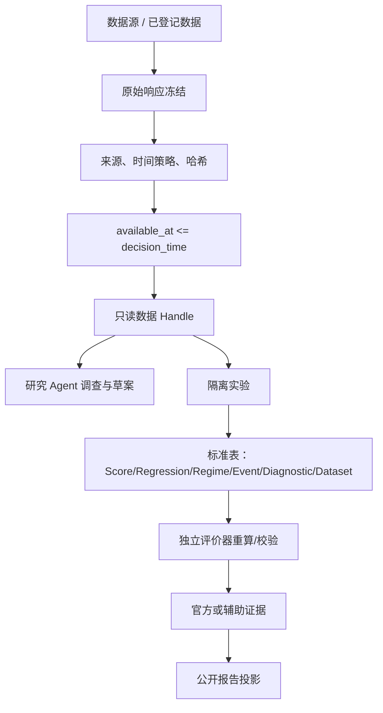

# AlphaForge 系统架构

## 架构结论

AlphaForge 不是单一框架，而是三种控制模式的组合：

1. Vibe 风格 `AgentLoop`：用于开放式、受限工具调查与研究草案；
2. Vibe 风格 Swarm/DAG：用于专业研究组隔离、依赖和并发调度；
3. VeriQuant 确定性内核：用于数据时点、隔离执行、标准输出、Evidence、Promotion、风险与审计。

核心原则是：**LLM 选择研究动作，DAG 决定任务依赖，确定性服务决定金融事实。**

## 产品控制流

```mermaid
flowchart LR
    U["用户研究问题"] --> P["Research Plan"]
    P --> C["用户显式确认"]
    C --> R["路由 1–6 个专业组"]
    R --> D["DAG 隔离调度"]
    D --> A["受限 AgentLoop"]
    A --> T["只读工具与冻结数据"]
    T --> S["研究草案 / 研究 Python"]
    S --> G["机械审查 Gate"]
    G --> X["无网络研究沙箱"]
    X --> O["标准输出合同"]
    O --> E["独立确定性评价"]
    E --> Q["Evidence / 负向 / 缺口"]
    Q --> M["中文用户报告"]
```



计划、运行、Evidence 和报告是不同状态，不应由一个 `success` 布尔值替代。

## 数据流



工具“查到了数据”不等于 Evidence 可以使用。中间必须保留原始响应、来源、字段语义、发布时间/可用时间、冻结身份和评价适配。

## 状态流

### 产品执行状态

```text
PLANNING
  → RESEARCHING
  → CANDIDATE_PREFLIGHT
  → AWAITING_EVIDENCE
  → COMPLETED | PARTIAL | BLOCKED | FAILED | CANCELLED
```

前端中文投影为：排队中、运行中、等待确认、已完成、部分完成、已阻断、失败、已取消。

### 研究候选状态

```text
DRAFT
  → DATA_VALIDATED
  → PIT_VALIDATED
  → EVALUATED
  → REVISE | REJECTED | VALIDATED_RESEARCH
  → CHALLENGER（只有独立机械规则可以进入）
```

### Harness 四维状态

| 维度 | 值 |
| --- | --- |
| execution_status | `NOT_RUN` / `PREFLIGHT_BLOCKED` / `RUNNING` / `PASSED` / `FAILED` |
| evidence_authority | `NONE` / `AUXILIARY_ONLY` / `OFFICIAL_EVIDENCE` |
| research_verdict | `SUPPORTED` / `CONDITIONALLY_SUPPORTED` / `REJECTED` / `INSUFFICIENT_EVIDENCE` / `DATA_UNAVAILABLE` |
| report_status | `NOT_BUILT` / `BUILT` / `QUALIFIED` / `REJECTED` |

四个维度必须分开。一次实验可以执行通过、只有辅助证据、条件支持，并成功生成报告。

## 权限流

| 行为 | Research Agent | 数据/沙箱 | Evidence | Promotion | 风险/组合 | 执行/账本 | 前端 |
| --- | --- | --- | --- | --- | --- | --- | --- |
| 提出假设和方法 | 允许 | 读取 | 否 | 否 | 否 | 否 | 提交问题/确认 |
| 生成研究代码 | DRAFT | 审查后隔离执行 | 否 | 否 | 否 | 否 | 只展示公开摘要 |
| 计算官方指标 | 禁止 | 输出标准表 | 独占 | 否 | 消费 | 消费 | 只读 |
| 晋级候选 | 建议 | 否 | 提供证据 | 独占机械决策 | 消费 | 否 | 只读 |
| 设置组合和风险例外 | 禁止 | 否 | 否 | 否 | 确定性服务 | 否 | 禁止 |
| 释放订单/修改账本 | 禁止 | 禁止 | 禁止 | 禁止 | 只提计划 | 独占且受 Gate | 禁止 |
| 取消研究运行 | 请求 | 控制器执行 | 否 | 否 | 否 | 否 | 允许调用研究取消 API |

## 组件到代码证据

| 组件 | 关键文件 | 作用 |
| --- | --- | --- |
| ReAct AgentLoop | `agent/src/agent/loop.py` | 有界模型-工具循环、迭代和终止 |
| ToolRegistry | `agent/src/agent/tools.py` | 工具合同、查找和执行 |
| 工具白名单 | `agent/src/tools/__init__.py` | 为 Agent 构造过滤后的能力视图 |
| 上下文 | `agent/src/agent/context.py` | 系统提示、记忆、技能、工具上下文 |
| Swarm 模型 | `agent/src/swarm/models.py` | Agent、Task、Run、Event 类型 |
| DAG 调度 | `agent/src/swarm/task_store.py`、`runtime.py` | 拓扑层、阻断、并发与聚合 |
| 隔离 Worker | `agent/src/swarm/worker.py` | 每组独立上下文与预算 |
| V3 产品服务 | `agent/src/veriquant/research_os_v3/product_service.py` | 计划、确认、运行、恢复与报告编排 |
| V3 API | `agent/src/api/research_os_v3_routes.py` | Research OS V3 控制与只读投影 |
| AlphaForge 专用服务器 | `agent/alphaforge_api_server.py` | 回环限定、禁用交易路由、静态前端 |
| 研究产品 | `agent/src/veriquant/agent_research_product/` | 问题到研究结果/报告的真实路径 |
| 研究沙箱 | `agent/src/veriquant/agent_research_sandbox/` | 审查、容器运行、标准输出与辅助证据 |
| Evidence 内核 | `agent/src/veriquant/evidence/` 及相关 evaluator | 确定性指标、身份和权威 |
| Campaign/报告 | `agent/src/veriquant/research_os_v3/`、报告模块 | 公开结果与 Markdown 报告 |
| 前端 V3 启动 | `frontend/src/features/research-os-v3-launch/` | 计划、运行、轮询、取消、恢复和报告读取 |
| 前端结果 | `frontend/src/features/research-os-v3/` | 合同归一化、公开字段与结果组件 |
| 页面路由 | `frontend/src/router.tsx` | AlphaForge 页面入口与旧路由重定向 |

## 复用边界

| 能力 | 来源 | 处理方式 | 原因 |
| --- | --- | --- | --- |
| AgentLoop、Provider、Trace | Vibe-Trading | 包装复用 | 避免重复建设成熟模型循环 |
| ToolRegistry 与数据 Loader | Vibe-Trading | 白名单包装 | 原始工具范围过宽，需冻结与分类 |
| Swarm/DAG | Vibe-Trading | 复用调度 | 支持依赖、并发和隔离 |
| 冻结身份、PIT、Evidence | VeriQuant | 保持权威 | 必须确定、可复放、独立于提议者 |
| 研究 Python | AlphaForge Research Sandbox | 独立路径 | 仅 DRAFT/辅助，禁止任意主机执行 |
| Promotion、Risk、Ledger | VeriQuant | 不暴露给 Agent | 金融事实和安全权限不可对话化 |
| Qlib 表达式 | 认证执行器 | 严格白名单 | 只输出非权威分数，不能替代证据链 |

## 运行表面

### AlphaForge 专用本地服务器

`agent/alphaforge_api_server.py` 只注册：

- Research OS V3 控制接口；
- Research OS V3 结果/报告接口；
- 只读 Workbench；
- `/healthz` 与 `/veriquant/status`；
- 构建后的前端静态文件。

它主动拒绝非回环 Host/Origin，并在启动时扫描路由，防止 Broker、Order、OAuth、Mandate、Account 或 V2 路由进入。

### Vibe 兼容一体化服务器

Dockerfile 默认运行 `vibe-trading serve`，注册 AlphaForge 之外的上游兼容功能。Compose 把宿主机端口绑定到 `127.0.0.1:8899`，但该进程的权限面仍大于专用服务器。产品演示和前端开发优先使用专用服务器；兼容功能或容器化一体部署才使用默认 Docker 服务。

## 持久化和产物

- `.autobuild/veriquant/`：研究数据、运行、报告、Evidence、Harness 收据；本地生成，默认不提交；
- `agent/runs/`、`agent/sessions/`：Vibe 兼容运行和会话；
- `run.json`/`manifest.json`：原子物化的运行状态；
- `events.jsonl`：追加事件；
- `trial-ledger.sqlite3`：研究尝试与预算事实；
- `report.json`/`report.md`：机器报告和用户报告；
- 哈希用于身份与复放，不应作为报告首页的主要内容。

## 当前架构债务

1. 根 `.autobuild/veriquant/state.json` 的 `current_prompt` 仍停在旧的 `IN_PROGRESS`，而更晚的产品门禁已经 `QUALIFIED`，需要统一单一状态源。
2. 本地专用服务器与 Docker 默认服务器不是同一权限面，需要后续增加经过测试的 AlphaForge-only 容器入口。
3. 前端存在 V3 启动、旧 Campaign、Workbench 等多套投影，需要收敛到 V3 主流程。
4. 前端开发代理当前未覆盖 `/api/veriquant/...`，应在前端实现阶段统一代理规则并测试。
5. 旧页面仍有“仅 FactorDAG、禁止研究 Python”的过时文案，与构建宪法 A-02 不一致。

这些债务是前端和产品收敛的优先输入，不能用再增加一个运行时来绕过。
