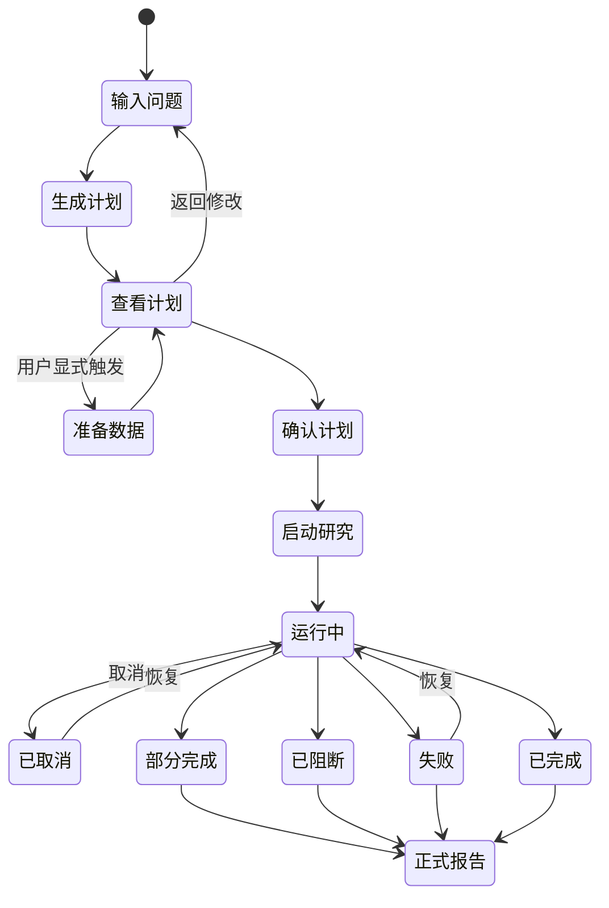

# AlphaForge 前端产品需求

版本：`frontend-product-requirements/v1`  
主要执行者：前端开发者或 AI 编程代理  
产品名：AlphaForge（千因研究院）

## 1. 目标

把当前多套 AlphaForge/V3/Workbench 页面收敛成一个用户能理解、机器状态不失真的研究产品：

```text
输入问题 → 查看计划 → 显式确认 → 运行研究 → 阅读结论 → 展开证据
```

前端的成功标准不是“页面更多”，而是用户无需理解 AgentLoop、FactorDAG、artifact hash 或内部 prompt，就能回答：

- 系统理解了什么问题？
- 会用什么数据和研究组？
- 当前运行到哪里？
- 哪些研究组完成、阻断或失败？
- 结论是什么？
- 这是官方 Evidence、辅助研究还是无证据？
- 原问题还有哪些部分没回答？
- 下一轮实验是什么？

## 2. 现有实现，必须复用

不要另建新前端工程。当前技术栈与可复用文件：

- React 19 + TypeScript + Vite；
- React Router：`frontend/src/router.tsx`；
- V3 启动流程：`frontend/src/features/research-os-v3-launch/`；
- V3 结果合同/组件：`frontend/src/features/research-os-v3/`；
- 启动页：`frontend/src/pages/ResearchOSV3LaunchPage.tsx`；
- 结果页：`frontend/src/pages/ResearchOSV3ResultPage.tsx`；
- 正式报告：`frontend/src/pages/FormalReportPage.tsx`；
- Workbench：`frontend/src/pages/VeriquantWorkbench.tsx`；
- Evidence：`frontend/src/pages/Evidence.tsx`；
- 因子中心：`frontend/src/pages/AlphaZoo.tsx`；
- 系统状态：`frontend/src/pages/SystemStatus.tsx`；
- 旧 Campaign UI：`frontend/src/pages/alphaforge/CampaignWorkspacePage.tsx` 与 `frontend/src/features/alphaforge/`；
- 全局布局：`frontend/src/components/layout/`；
- 已安装报告依赖：`react-markdown`、`remark-gfm`、`highlight.js`；
- 测试：Vitest + Testing Library。

新主流程以 Research OS V3 为唯一产品合同。旧 Campaign/fixture 客户端只做兼容或逐步移除，不能成为生产失败时的成功回退。

## 3. 当前必须解决的问题

### P0 产品问题

1. 启动页创建计划后立即自动确认，用户没有真正看到确认边界。
2. V3、旧 Campaign、Workbench 有重复页面和不同状态词。
3. 正式报告存在逐行手写 Markdown parser，无法完整处理 GFM 表格、列表和嵌套内容。
4. 官方/辅助/无 Evidence 的展示尚未在所有页面统一。
5. `SystemStatus` 仍写“只允许 FactorDAG、禁止任意 Python”，与 A-02 受限研究 Python 路径冲突。
6. Vite 原先没有 `/api/veriquant` 代理；配置已补，必须加测试防回归。
7. 旧 Campaign 客户端可回退 deterministic fixture；V3 产品流必须 fail closed。
8. 报告页、Evidence 页和 Workbench 的用户关系不清楚。
9. 运行阶段的慢本地步骤、模型调用和沙箱执行没有统一可见性。
10. 窄屏、键盘、焦点、空状态和损坏合同状态需要系统验收。

## 4. 非目标

本轮前端不得：

- 重写 Research OS V3 后端；
- 新增 Broker、订单、真实账户、Mandate、OAuth 或交易入口；
- 让浏览器写 Evidence、Promotion、风险、组合或账本；
- 暴露 `.autobuild` 绝对路径或任意文件浏览；
- 为展示需要修改机器指标或报告权威；
- 把 sealed 内容、内部 Prompt、密钥或未知 JSON 渲染出来；
- 创建新的 Campaign 状态机；
- 为某一个示例问题硬编码结果；
- 加入生产网络分析脚本或外部字体请求。

后端合同确有缺字段时，先写清缺口和最小接口变更，不在前端推断。

## 5. 品牌与术语

### 用户可见

- 产品：AlphaForge；
- 中文全称：千因研究院；
- 主流程：研究、研究计划、专业研究组、机器评价、证据、正式报告；
- 不用“Vibe-Trading”作为页面品牌；
- “VeriQuant”只在高级系统状态中显示为可信研究内核。

### 状态用词

运行：排队中、运行中、等待确认、已完成、部分完成、已阻断、失败、已取消。

证据：官方 Evidence、辅助研究、未形成 Evidence。

研究处置：进入下一轮验证、条件保留、拒绝、补充数据/能力、修复系统。

不要把 `COMPLETED` 翻译成“验证成功”，也不要把“进入短名单”写成“晋级”。

## 6. 信息架构

### 顶级导航

保持 5 个主入口，减少认知负担：

1. 研究：`/`、`/research`；
2. 报告：`/reports`；
3. Evidence：`/evidence`；
4. 因子中心：`/factors`；
5. 系统：`/system`。

Workbench 是高级详情，不作为最重要的一级入口；从报告/Evidence 中进入。

### 路由

| 路由 | 页面职责 |
| --- | --- |
| `/`、`/research` | 问题、计划、确认和启动 |
| `/research/results/:runId` | 实时运行与终态结果 |
| `/reports` | 报告历史、搜索和合法终态筛选 |
| `/reports/:runId` | 正式中文报告 |
| `/evidence` | 官方/辅助/无证据分类与公开证据详情 |
| `/factors`、`/factors/:alphaId` | 因子目录和研究入口 |
| `/system` | 服务、数据、Provider、Sandbox 和安全状态 |
| `/veriquant/workbench` | 高级机器详情，保留兼容 |

旧 `/campaign/**`、`/agent`、`/runtime`、`/settings` 等继续安全重定向，不在导航出现。

## 7. 核心用户流程



## 8. 页面详细需求

### 8.1 全局布局

顶部导航包含 AlphaForge 标识、当前主入口和系统连接状态。桌面保持轻量 sticky 导航；移动端使用可访问的折叠菜单。

必须：

- 跳转后更新页面标题；
- `main` landmark 和 skip link；
- 当前路由 `aria-current=page`；
- 不把连接绿点作为唯一状态说明；
- 页面最大内容宽度保持可读，报告正文窄于数据表。

### 8.2 研究首页：问题输入

首屏只强调一件事：输入 Alpha 问题。

组件：

- 品牌短句；
- 多行问题输入；
- 三到五个可点击示例；
- 研究深度选择；
- 协作方式选择；
- “生成研究计划”主按钮；
- 产品边界短说明：“研究结果不等于交易建议”。

校验：去除首尾空白；空问题阻止提交；限制合理长度；busy 时防重复；错误后保留用户输入。

### 8.3 计划预览与显式确认

生成计划后不自动确认。页面切换为计划审阅：

- 原始问题；
- 研究目标/对象；
- 选中研究组及每组计划；
- 数据源、股票池、日期和可用性；
- 数据限制；
- 预算；
- 检查点；
- 停止条件；
- “返回修改”“确认并开始研究”；
- 数据不可用时提供“显式准备数据”或“仍以部分研究继续”，以后端允许为准。

确认按钮文案必须包含动作后果。确认和启动可以连续发生，但 UI 状态必须分开，避免双提交。

### 8.4 运行结果页

页面头部：研究问题、run ID（可复制）、总体状态、当前阶段、耗时和停止操作。

核心布局：

```text
┌ 研究问题 + 总状态 + 操作 ┐
├ 当前阶段时间线            ┤
├ 选中的专业研究组卡片网格  ┤
├ 预算与产物摘要            ┤
├ typed failures / 限制     ┤
└ 终态后：结论和报告入口    ┘
```

专业组卡片只显示选中组：名称、状态、候选数、当前消息。未选择组不展示失败。分组失败不覆盖总体合法部分结果。

阶段信息应区分：数据冻结/校验、模型研究、代码审查、隔离执行、机器评价、报告发布。后端只返回粗阶段时使用中性文案，不虚构百分比。

取消：运行时可用，要求二次轻确认；调用后立即禁用重复点击，等待后端终态。

恢复：仅失败/取消且后端支持时显示；使用原 Campaign；说明已完成步骤不会重复。

### 8.5 终态摘要

在结果页报告之前展示：

- 一句话结论；
- 研究处置；
- 合法 outcome；
- Evidence 等级；
- 原问题完成度；
- 最重要的 3–6 个发现；
- 关键限制；
- “阅读正式报告”“查看 Evidence/Workbench”。

部分、阻断、负向结果必须有完整设计，不能只显示红色错误页。

### 8.6 正式报告页

使用 `react-markdown` + `remark-gfm`，禁用 raw HTML。支持：

- H1–H4；
- 有序/无序列表；
- 表格；
- blockquote；
- inline/fenced code；
- details 如果安全策略不允许 raw HTML，则由结构化 JSON 或自定义安全组件替代；
- 内部锚点；
- 安全外链。

报告页结构：

1. 标题、问题、日期、Evidence 徽章；
2. 一句话结论卡；
3. 处置建议；
4. Markdown 正文；
5. 固定侧边/底部目录（长报告）；
6. 复制链接/导出打印；
7. 展开机器详情入口。

表格窄屏横向滚动，表头 sticky 可选。数字使用等宽数字，但不能由前端重新计算或舍入成不同结论。

### 8.7 报告中心

列表显示：问题摘要、时间、总体结果、Evidence 等级、研究组数和限制标记。

支持：文本搜索、结果筛选（完成/部分/阻断/失败）、Evidence 筛选（官方/辅助/无）、排序。筛选只作用于已加载公开字段。

空状态引导发起研究，不展示假数据。

### 8.8 Evidence

目的：解释结论为什么可信，而不是展示哈希墙。

每个运行显示：

- Evidence 权威等级（文字 + 图标 + 色彩）；
- 数据范围和冻结状态；
- 机器评价状态；
- Critics；
- Promotion 状态（如果有，明确“短名单不等于晋级”）；
- lineage/citation；
- 可展开哈希和稳定 ID。

sealed 只显示“存在/未运行/拒绝”等允许状态，不显示指标、排名、路径或原因细节。

### 8.9 因子中心

保持只读目录：名称、家族、版本、谱系、资格和允许公开摘要。因子可以成为新研究问题的起点，但页面不能执行任意源代码或直接晋级。

### 8.10 系统状态

分为：

- AlphaForge API；
- 冻结数据；
- LLM Provider（只显示脱敏 host/model/configured）；
- Research Sandbox（可用/镜像缺口）；
- Evidence/报告服务；
- 当前已知限制。

修正文案：受限 generated Python 已由 A-02 授权进入独立研究沙箱；仍禁止主机任意执行。Qlib 表达式和 legacy FactorDAG 需正确区分。

不要把静态写死的 `COMPLETED` 当实时健康状态。

## 9. 合同与数据所有权

### 计划合同

使用 `V3CampaignPlanView`，展示 `selectedSpecialists`、`dataScope`、`budget`、`checkpoints` 和 `stopConditions`。任何缺失字段使计划 fail closed。

### 运行合同

使用 `V3ResearchRunControlView`。总体状态和每组状态分开。`usedBudget <= totalBudget`，违反时关闭页面并报合同错误。

### 报告合同

优先消费后端结构化 JSON 做摘要，Markdown 做正文。前端不从 Markdown 关键字猜 outcome/Evidence。

### 后端是唯一事实源

- URL 可以保存 run ID；
- localStorage 最多保存非敏感最近 ID/用户 UI 偏好；
- 不在浏览器生成 official metrics；
- 不缓存 sealed 或未知 payload；
- 刷新页面后从 API 重建状态。

## 10. Evidence 视觉规范

| 等级 | 标签 | 视觉 | 必须附带文案 |
| --- | --- | --- | --- |
| 官方 | 官方 Evidence | 蓝/绿盾牌 | 独立确定性服务、冻结/PIT 合格 |
| 辅助 | 辅助研究 | 紫/琥珀烧瓶 | 不等同官方指标，不可直接晋级 |
| 无 | 未形成 Evidence | 中性灰 | 数据、能力、样本或评价器原因 |
| sealed | 封闭门禁状态 | 锁图标 | 不公开指标或原因细节 |

色彩不能是唯一区分；每处都要有文字。

## 11. 视觉语言

### 总体方向

专业研究工作台，克制、可信、答案优先。避免“加密交易大屏”、霓虹行情、过度渐变和每张卡片都玻璃化。

### 建议 Token

```text
canvas       #F5F5F7
surface      #FFFFFF
surfaceGlass rgba(255,255,255,.78)
ink          #101114
muted        #62666D
line         rgba(16,17,20,.10)
brand        #007AFF
positive     #16845B
warning      #A56512
danger       #C43D3D
auxiliary    #6F5AA8
```

允许与现有 token 系统对齐，不要求组件内硬编码颜色。

### 布局

- 44–52px 顶部导航；
- 内容区大留白；
- 研究输入最大宽度约 900px；
- 报告正文 760–860px，表格可突破正文宽度；
- 卡片圆角和阴影轻量；
- 液态玻璃只用于导航、状态与操作面板；
- 本地字体，正文 Inter/系统中文字体，机器 ID 使用 JetBrains Mono。

### 动效

- 150–220ms 状态过渡；
- 尊重 `prefers-reduced-motion`；
- 不用无限动画假装精确进度；
- 运行中允许低干扰呼吸状态，不影响阅读。

## 12. 响应式

### 桌面 ≥ 1200px

运行页可用两列，报告可有目录侧栏。

### 平板 768–1199px

专业组 2 列，目录折叠，操作保持可触达。

### 手机 < 768px

单列；顶部导航折叠；表格横向滚动；长 ID 截断但可复制；主要操作使用底部或自然流，不覆盖内容。

最低验收宽度：360px。不得出现全页横向滚动。

## 13. 可访问性

最低目标 WCAG 2.1 AA：

- 全流程键盘可完成；
- 清晰 focus ring；
- 表单有 label、描述和错误关联；
- 状态更新用适度 `aria-live`，不播报每次轮询；
- 颜色对比合格；
- 图标有文本或 `aria-hidden`；
- 模态框焦点锁定与返回；
- 表格有语义表头；
- 加载 skeleton 不替代可访问文本；
- 页面标题和主 heading 唯一明确。

## 14. 网络、轮询与恢复

- 所有请求使用同源相对路径；
- Vite 代理目标由环境变量配置；
- 运行轮询初始 1–1.5 秒，可逐步到 3 秒；
- 页面不可见时降频；
- 新运行或路由变化时 abort 旧请求；
- 终态停止轮询；
- 400/403/404/409/422 不自动重试；
- 网络断开/5xx 允许有界重试，并显示尝试次数；
- 取消/恢复/启动按钮防双击；
- 刷新后用 URL run ID 恢复；
- 不从前端重新启动已完成分支。

## 15. 安全和隐私

- 不渲染未知字段；
- 运行时解析器严格校验 JSON；
- Markdown 不启用 raw HTML；
- 外链添加安全 rel；
- 不使用 `dangerouslySetInnerHTML`；
- 不在 console 打印完整响应、Prompt、代码、数据或密钥；
- 不把 `.autobuild` 路径传给浏览器；
- 不注册交易路由；
- 不在 `VITE_*` 放密钥；
- 公开错误只显示 typed code 和可操作说明。

## 16. 实现阶段

### F0：基线与合同

- 运行现有测试/build；
- 列出主路径和兼容路径；
- 固定 V3 类型和 API；
- 为 `/api/veriquant` 代理加测试。

验收：无功能改动，基线结果记录。

### F1：品牌、导航、路由

- AlphaForge 统一品牌；
- 5 个主导航；
- 旧路由安全重定向；
- 页面 title、skip link 和移动导航。

### F2：问题与计划确认

- 拆开 create/confirm/start；
- 计划完整展示；
- 返回修改；
- 显式数据准备；
- 防双提交。

### F3：运行与专业组

- URL 化 run ID；
- 轮询/abort/降频；
- 阶段时间线；
- 研究组卡；
- 预算；
- typed failures；
- 取消/恢复。

### F4：结果与正式报告

- outcome/Evidence/处置摘要；
- GFM 渲染；
- 表格、目录和窄屏；
- 报告列表和深链。

### F5：Evidence、系统状态和兼容清理

- 统一权威徽章；
- 修正过时文案；
- Workbench 高级入口；
- 旧 fixture 生产回退移除。

### F6：质量与验收

- 响应式；
- 键盘/焦点；
- 错误/空/损坏；
- 视觉回归/浏览器 smoke；
- 完整 test/build。

每个阶段一个可审查 PR，不把全前端一次性重写。

## 17. 测试矩阵

### Client/合同

- 正常 plan/run/report；
- product availability 中文映射；
- 缺字段、未知状态、负预算、used > total；
- AbortError；
- 网络错误、非 JSON、空 Markdown；
- ID URL encoding；
- `/api/veriquant` proxy 配置。

### 用户流程

- 空问题；
- 生成计划后不自动确认；
- 返回修改保留输入；
- 确认后只启动一次；
- 显式 prepare-data；
- 运行到完成/部分/阻断/失败/取消；
- 取消和恢复；
- 刷新 URL 恢复；
- 终态停止轮询。

### 研究组

- 只显示选中组；
- 一组失败、其他组完成，总体部分完成；
- DATA_GAP 与 provider failure 文案不同；
- 候选数为 0 的合法负向/缺口。

### 报告与 Evidence

- GFM 表格、列表、代码；
- raw HTML 不执行；
- 官方、辅助、无 Evidence；
- 短名单不显示晋级；
- sealed 不泄漏；
- 报告 404/409/空内容。

### 可访问性/响应式

- 360、768、1440 三档；
- 键盘 tab 顺序；
- modal focus；
- aria labels/live；
- reduced motion；
- 表格不造成整页横向滚动。

## 18. Definition of Done

- [ ] 产品只使用 AlphaForge（千因研究院）品牌；
- [ ] 研究主流程只依赖 V3 合同；
- [ ] 计划必须显式确认；
- [ ] 运行状态、研究组、预算、取消/恢复可用；
- [ ] 合法负向、部分、缺口、失败和取消都有完整页面；
- [ ] 报告用安全 GFM 渲染；
- [ ] 官方/辅助/无 Evidence 在所有页面一致；
- [ ] 无 sealed/secret/未知字段泄漏；
- [ ] `/api/veriquant` 本地和 Docker profile 代理可用；
- [ ] 360px 无整页横向滚动；
- [ ] 键盘可完成主流程；
- [ ] `npm run test:run` 通过；
- [ ] `npm run build` 通过；
- [ ] 相关后端 V3 窄集通过；
- [ ] 提供桌面和移动截图；
- [ ] PR 描述记录测试、已知限制和未做事项。

## 19. 交付物

前端执行者最终应交付：

1. 修改后的 `frontend/src/**`；
2. 必要的 `frontend/vite.config.ts`/Compose 开发配置；
3. 新增或更新的 Vitest；
4. 桌面/移动截图；
5. 测试和 build 结果；
6. API 合同变更说明（如果有）；
7. 仍存在的后端/数据缺口；
8. 不包含秘密、运行数据或真实交易权限的 PR。
