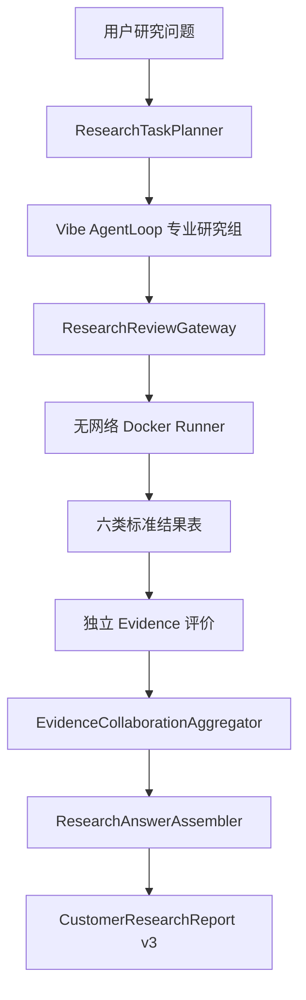

# ResearchAnswer v3：从机器指标到明确研究答案

## 目标

ResearchAnswer v3 解决的是产品主链最后一公里：研究组已经完成调查、代码审查、隔离实验和 Evidence 评价后，系统必须回答用户原问题，而不是只展示任务 ID、哈希或指标表。

它不修改 PIT、Evidence、Promotion、组合、风险或执行真值，也不允许 LLM 编写官方指标。其职责是把已经存在且可追溯的机器事实确定性地组织为：

- 一句话直接答案；
- 每个候选的定义、方法和处置；
- 原问题逐项回答；
- 支持与反对证据；
- 已测试、未测试、冲突和下一项实验；
- 面向客户的中文正式报告。

## 唯一主链

Vibe 的 AgentLoop、Provider、只读研究工具和多组调度继续负责自主研究；VeriQuant 的审查、隔离运行、标准输出、Evidence 和权限边界不变。ResearchAnswerAssembler 不计算金融指标，只读取已登记结论。

## 核心合同

代码位于 `agent/src/veriquant/research_answer/`：

- `ResearchAnswerSpec`：绑定原问题、任务和需要回答的标准输出类型；
- `CandidateDefinition`：记录候选来源、研究组、假设、方法、数据和 Evidence；
- `QuestionPartAnswer`：对问题的一部分给出回答状态、判断和证据；
- `CandidateDecision`：逐候选保留、条件保留、修订、拒绝或未评价；
- `ResearchAnswer`：稳定序列化的最终答案对象。

合法回答状态：

- `ANSWERED`
- `CONDITIONALLY_ANSWERED`
- `NEGATIVE_ANSWER`
- `PARTIALLY_ANSWERED`
- `UNANSWERABLE_WITH_REASON`

“没有找到有效 Alpha”是合法的负向答案；“缺少事件结果表”必须给出恢复条件；只有基础设施失败才属于系统失败。

## 六类显式答案适配

| 标准输出 | 用户得到的答案 |
|---|---|
| `ScoreTable` | 预测关系、成本后收益、换手、分期/分状态稳定性和增量性 |
| `RegressionTable` | 控制变量后的系数、p 值、样本量和共线诊断 |
| `RegimeComparisonTable` | 各状态效应、状态差、最小样本和方向稳定性 |
| `EventTable` | 事件数、事件窗、CAR、对照调整和安慰剂结果 |
| `DiagnosticTable` | 根因指标、支持/反对证据与下一项修复实验 |
| `DatasetAssessmentTable` | 字段覆盖、PIT 资格、观测数和研究适用性 |

适配器只解释评价器已产生的指标。它不会从问题关键词猜测结论，也不会把相关性记录为 0 自动解释成“低相关”；该情形会明确要求核对基准因子是否实际载入。

## 协作结论

产品路径使用 `EvidenceCollaborationAggregator.summarize_experiments()`：

- 一条候选被拒绝不会抹掉另一条有效候选；
- 同指标方向冲突、结论冲突、Official/Auxiliary 混合会显式登记；
- 每个候选单独处置；
- 研究组之间传递标准表和 Evidence，不用自由文本冒充证据；
- 聚合器没有 Promotion 权限。

## 报告规则

客户正文按以下顺序展示：

1. 一句话答案；
2. 最终判断和证据等级；
3. 候选定义和处置；
4. 原问题逐项回答；
5. 支持与反对证据；
6. 研究计划、调查、代码审查和隔离实验过程；
7. 冲突、限制、未测试项和下一项实验。

哈希、内部任务 ID 和技术收据保留在 JSON 机器产物，不堆入客户正文。所有数字必须来自 Evidence 绑定事实。

## 历史真实运行升级

`LegacyProductRunBackfiller` 可以把已有的真实模型、审查、Docker 和 Evidence 收据离线升级为 v3 报告。它：

- 不调用模型；
- 不运行研究代码；
- 不重算指标；
- 校验原 manifest、report、review、runner 和 Evidence 身份；
- 写入独立 `research_answer_v3_backfill/`，不覆盖原报告；
- 保留原研究计划和调查过程。

这用于报告层迁移，不能把未评价实验变成已评价结果。

## 当前验证

- 500/500 研究问题可稳定编译 AnswerSpec；
- 6/6 标准输出有显式答案适配器；
- ResearchAnswer、候选、协作和报告产物已接入唯一产品服务；
- 终端返回答案状态、研究结论、直接答案和答案路径；
- 75 项窄回归通过；
- 代表案例 Harness 当前为 16/24，其中真实产品收据 4/12，状态必须保持 `PARTIAL`。

